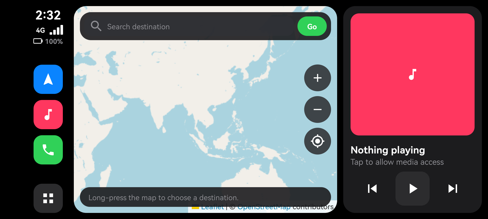
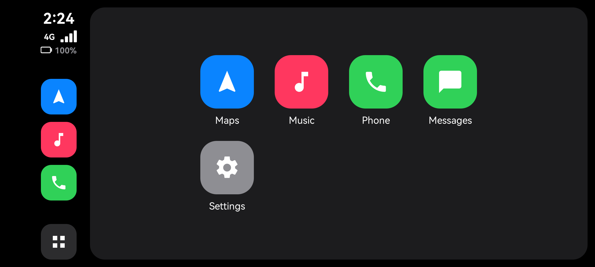
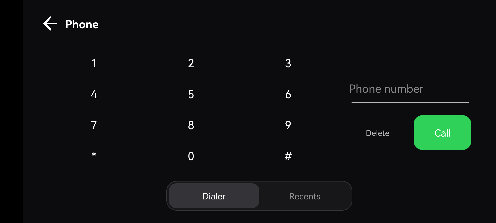

# Petal Drive

Petal Drive is a landscape Android driving dashboard designed for a phone or tablet mounted in a car. It brings a map and route preview, media controls, phone tools, and notification-based message view together in a touch-friendly interface. It is an independent project, not Apple CarPlay, Android Auto, or turn-by-turn navigation software.

## Screenshots

| Dashboard | App menu | Phone dialer |
| --- | --- | --- |
|  |  |  |

## Features

- **Map and route preview:** Search for a destination, choose points on the map, see route distance and estimated time, and center the map on your current location.
- **Basic rerouting:** While a route is active, Petal Drive checks GPS fixes for off-route movement and can request an updated route.
- **Dashboard:** Shows battery percentage and, with optional Phone permission on supported devices, cellular network type and signal strength.
- **Now Playing:** Displays the active Android media session and offers playback controls. Notification access is needed to discover media sessions.
- **Phone:** Includes an in-app dialer and recent-call view. Making calls and reading call history require the corresponding Android permissions.
- **Messages:** Displays message notifications; it is not an SMS inbox or messaging service.
- **Responsive layout:** Uses a side rail on phones and bottom navigation on tablets and wide screens.
- **App menu:** Shortcuts for Maps, Music, Phone, Messages, and Android Settings.

## Supported devices

- Android **8.0 (API 26) or newer**.
- Android phones, tablets, and compatible head units that can run Android apps.
- **Landscape orientation** is required; the app follows either landscape rotation.
- GPS/location and an internet connection are needed for current-location routing and online map/search/route services. Manual map selection can be used to set route points.
- Cellular hardware is optional. Devices without telephony can still use the dashboard, map, media, and other available features; cellular status and calling depend on device hardware and permissions.

The app is built with `minSdk 26`, `targetSdk 34`, and `compileSdk 34`. It has been exercised on Android 10 phones and tablets, but not every device model or Android skin has been tested.

## Install a beta

Download **`PetalDrive-0.1-Beta.apk`** from the [GitHub Releases](https://github.com/eun0115/CarAuto/releases) page, install it, and approve Android's install prompt. Android may ask you to allow installs from the app you used to open the APK.

The release workflow attaches this APK when a GitHub release is published. It is built with debug signing for direct beta testing; it is not a Play Store-ready production release. Android will not install it as an update over a build signed with a different key.

## Build from source

Requirements: Android Studio with JDK 17, or JDK 17 and the included Gradle wrapper.

```powershell
.\gradlew.bat assembleDebug
```

On macOS or Linux:

```sh
./gradlew assembleDebug
```

The debug APK is written to `app/build/outputs/apk/debug/app-debug.apk`. The release workflow renames the installable beta artifact to `PetalDrive-0.1-Beta.apk`.

## Permissions and privacy

Android prompts for permissions when a feature needs them:

| Permission or access | Used for |
| --- | --- |
| Location | Showing your position and calculating routes from your current location. |
| Phone state (optional) | Cellular network type and signal display. |
| Call phone / call history | Placing calls and showing recent calls in the Phone screen. |
| Notification access (optional) | Reading media-session details and displaying message notifications. |
| Internet / network state | Map tiles, place search, route lookup, and connectivity status. |

Location, place searches, and route requests are sent to the relevant map/geocoding/routing services. Message and media information comes from Android notification/media access on the device. Review the external services' policies before use.

## Maps, services, and licenses

- **OpenStreetMap data:** © OpenStreetMap contributors, available under the [Open Database License (ODbL) 1.0](https://www.openstreetmap.org/copyright). Map attribution is shown in the app.
- **OpenStreetMap tile service:** The app uses the public `tile.openstreetmap.org` endpoint. Tiles are subject to the [tile usage policy](https://operations.osmfoundation.org/policies/tiles/); the public service is not guaranteed for production traffic.
- **Place search:** Uses the public [Nominatim](https://nominatim.org/) service. Searches are explicit (not autocomplete) and limited to one request per second. Follow the [Nominatim usage policy](https://operations.osmfoundation.org/policies/nominatim/).
- **Route calculation:** Uses the public [OSRM demo server](https://router.project-osrm.org/), which has no availability or production-use guarantee.
- **Leaflet:** Bundled under the BSD 2-Clause License; see [`leaflet-license.txt`](app/src/main/assets/map/leaflet-license.txt).
- **AndroidX libraries:** Distributed under the Apache License 2.0; see the [AndroidX project](https://github.com/androidx/androidx).
- **Petal Drive code and original UI assets:** This repository does not currently include a project-level `LICENSE` file. No license for reusing or redistributing those project materials is specified here.

## Limitations

- Maps, place search, and route estimates require internet access and public service availability.
- Routes and ETAs are estimates, and rerouting is basic. Petal Drive does not provide turn-by-turn voice guidance or launch another navigation app.
- The app is landscape-only and is not certified for use while driving. Set up destinations and controls before moving; always obey local laws and drive safely.
